# CS6650 Homework 5: Product API on ECS with Terraform

Kirtan Patel · Building Scalable Distributed Systems

The first piece of a simple online store: a Go/Gin **Product API** implementing the Product endpoints of `api.yaml`, packaged with Docker, deployed to AWS ECS (Fargate) with Terraform, load- and stress-tested with Locust, and observed with Prometheus, Grafana and structured JSON logs.

**Contents:** [Repository layout](#repository-layout) · [The API](#the-api) · [Run locally](#run-locally) · [Every response code](#every-response-code) · [Deploy to AWS](#deploy-to-aws-on-any-machine) · [Part IV: Load testing](#part-iv-load-and-stress-testing) · [Part V: Observability](#part-v-observability) · [Interview prep](docs/INTERVIEW_PREP.md)

## Repository layout

| Path | What it is |
|---|---|
| `src/product-service.go` | The server: handlers, validation, in-memory store, metrics, logging |
| `src/go.mod`, `src/go.sum` | Go module and pinned dependencies |
| `src/Dockerfile` | Multi-stage build: compiles a static binary, ships it on Alpine |
| `terraform/` | Infrastructure as code (forked from the course starter): ECR, ECS, networking, logging modules |
| `scripts/test_all_codes.sh` | One curl per response code, for a local or deployed server |
| `scripts/get_task_ip.sh` | Prints the public IP of the running ECS task |
| `locust/` | Locustfile (HttpUser/FastHttpUser switch, stress mode, step shape) and master/worker compose file |
| `observability/` | Local Prometheus + Grafana stack with a pre-provisioned RED dashboard |
| `screenshots/` | Evidence for every section below |
| `docs/INTERVIEW_PREP.md` | Answers to the mock interview questions, including the design questions |

## The API

| Endpoint | Purpose | Responses (from `api.yaml`) |
|---|---|---|
| `GET /products/{productId}` | Get one product | 200 product JSON · 404 not found · 500 server error |
| `POST /products/{productId}/details` | Add or update a product's details | 204 no body · 400 invalid input · 404 not found · 500 server error |
| `GET /health` | Liveness check (not in the spec) | 200 |
| `GET /metrics` | Prometheus metrics (not in the spec) | 200 |

A `Product` has six required fields: `product_id` (int32 ≥ 1), `sku` (1–100 chars), `manufacturer` (1–200 chars), `category_id` (int32 ≥ 1), `weight` (int32 ≥ 0, grams) and `some_other_id` (int32 ≥ 1). Every integer is `format: int32`, so values above 2,147,483,647 are rejected too. Errors use the spec's `Error` schema: `{"error": "...", "message": "...", "details": "..."}`.

**Design decisions:**

- **Storage: a Go map protected by a `sync.RWMutex`.** Every operation is a lookup by ID, which a hash map does in O(1). Reads dominate (~80% of traffic), and an RWMutex lets any number of GETs read at once while POSTs take the exclusive lock. Without the lock, concurrent writes crash the process with `fatal error: concurrent map writes`.
- **POST updates an existing product.** The spec calls it "add or update detailed information for a specific product" and lists 404, so the product must exist. The server starts with a seeded catalog (products `1..SEED_PRODUCTS`, default 1000).
- **An invalid ID on GET returns 404, not 400.** GET lists only 200, 404 and 500, so `/products/abc` or `/products/0` gets 404: no product can have that ID. POST does list 400, so an invalid path ID there is a 400.
- **The body's `product_id` must match the path's `productId`**, otherwise 400, so a client can't write product 7's data into product 2.
- **500 is demonstrated with fault injection.** A correct server shouldn't produce 500s, so it panics only when `ENABLE_FAULT_INJECTION=true` *and* the request has `X-Fault-Injection: 500`. Gin's recovery middleware turns the panic into a proper 500 `Error` body. It is enabled locally only, never on ECS.
- **No authentication.** The spec declares API-key and Bearer schemes globally but defines no 401 for these endpoints, so auth is out of scope here.

| Env var | Default | Meaning |
|---|---|---|
| `PORT` | `8080` | Must match `container_port` in `terraform/variables.tf` |
| `SEED_PRODUCTS` | `1000` | Size of the starting catalog |
| `ENABLE_FAULT_INJECTION` | off | `true` enables the `X-Fault-Injection: 500` header |
| `GIN_MODE` | `release` (in Docker) | Gin's mode |

## Run locally

**Prerequisites:** Go 1.22+, Docker Desktop.

```bash
cd src
go mod tidy
ENABLE_FAULT_INJECTION=true go run .          # server on :8080

# or in Docker
docker build -t product-service .
docker run --rm -p 8080:8080 -e ENABLE_FAULT_INJECTION=true product-service
```

Then, from the repo root in another terminal:

```bash
./scripts/test_all_codes.sh http://localhost:8080
```

## Every response code

`scripts/test_all_codes.sh` sends 16 requests that together trigger every response code defined for both endpoints. All 16 returned the expected status with `go run` and inside Docker, and every check captured on ECS matched.

| Case | Request | Status |
|---|---|---|
| Existing product | `GET /products/1` | **200** |
| Missing product | `GET /products/999999` | **404** |
| Invalid ID (not an integer / below 1) | `GET /products/abc`, `GET /products/0` | **404** |
| Server fault | `GET /products/1` + `X-Fault-Injection: 500` | **500** |
| Valid details | `POST /products/1/details` | **204**, verified by a follow-up GET |
| Malformed JSON, missing fields, constraint violations, wrong type, invalid path ID, int32 overflow, body/path ID mismatch | `POST /products/{id}/details` | **400** |
| Missing product | `POST /products/999999/details` | **404** |
| Server fault | `POST /products/1/details` + `X-Fault-Injection: 500` | **500** |

**Example calls:**

```bash
curl -i http://localhost:8080/products/1
# HTTP/1.1 200 OK
# {"product_id":1,"sku":"SKU-000001","manufacturer":"Acme Corporation","category_id":2,"weight":101,"some_other_id":1}

curl -i http://localhost:8080/products/999999
# HTTP/1.1 404 Not Found
# {"error":"NOT_FOUND","message":"Product not found","details":"no product with product_id 999999"}

curl -i -X POST http://localhost:8080/products/1/details \
  -H 'Content-Type: application/json' \
  -d '{"product_id":1,"sku":"ABC-123-XYZ","manufacturer":"Acme Corporation","category_id":456,"weight":1250,"some_other_id":789}'
# HTTP/1.1 204 No Content

curl -i -X POST http://localhost:8080/products/1/details \
  -H 'Content-Type: application/json' -d '{"product_id":1,"sku":"X"}'
# HTTP/1.1 400 Bad Request
# {"error":"INVALID_INPUT","message":"Invalid input data","details":"manufacturer is required; category_id is required; weight is required; some_other_id is required"}

curl -i -H 'X-Fault-Injection: 500' http://localhost:8080/products/1      # server needs ENABLE_FAULT_INJECTION=true
# HTTP/1.1 500 Internal Server Error
# {"error":"INTERNAL_ERROR","message":"Internal server error"}
```

### Local, `go run`

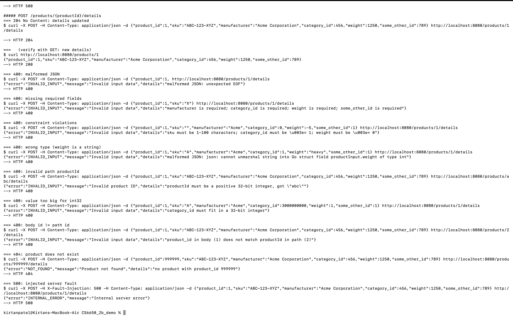

### Local, Docker

The image builds with the multi-stage Dockerfile (the first `docker run` failed only because the `go run` server still held port 8080; it was stopped and the container started cleanly).

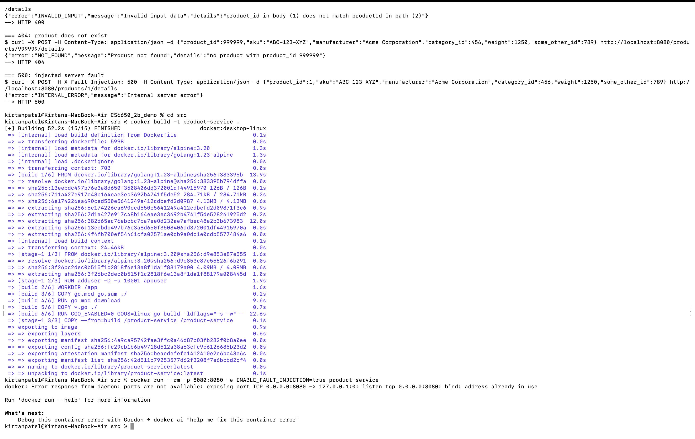

Running the same 16 checks against the container, its JSON request logs show every request arriving inside Docker: the timestamps are in UTC (the container's clock), `client_ip` is Docker Desktop's gateway `192.168.65.1`, and there's no Gin debug banner because the Dockerfile sets release mode. Each 500 has a matching `panic recovered` line:

```json
{"time":"2026-10-19T14:25:23.853658133Z","level":"INFO","msg":"request","method":"GET","endpoint":"/products/:productId","path":"/products/1","status":200,"duration_ms":1.33,"bytes":116,"client_ip":"192.168.65.1"}
{"time":"2026-10-19T14:25:23.889920799Z","level":"INFO","msg":"request","method":"GET","endpoint":"/products/:productId","path":"/products/999999","status":404,"duration_ms":0.962,"bytes":97,"client_ip":"192.168.65.1"}
{"time":"2026-10-19T14:25:23.971189549Z","level":"ERROR","msg":"panic recovered","error":"injected fault for testing the 500 response","path":"/products/1"}
{"time":"2026-10-19T14:25:23.971248008Z","level":"INFO","msg":"request","method":"GET","endpoint":"/products/:productId","path":"/products/1","status":500,"duration_ms":3.113,"bytes":60,"client_ip":"192.168.65.1"}
{"time":"2026-10-19T14:25:23.996837966Z","level":"INFO","msg":"request","method":"POST","endpoint":"/products/:productId/details","path":"/products/1/details","status":204,"duration_ms":0.137,"bytes":-1,"client_ip":"192.168.65.1"}
{"time":"2026-10-19T14:25:24.045137924Z","level":"INFO","msg":"request","method":"POST","endpoint":"/products/:productId/details","path":"/products/1/details","status":400,"duration_ms":0.096,"bytes":99,"client_ip":"192.168.65.1"}
{"time":"2026-10-19T14:25:24.183336091Z","level":"INFO","msg":"request","method":"POST","endpoint":"/products/:productId/details","path":"/products/999999/details","status":404,"duration_ms":0.077,"bytes":97,"client_ip":"192.168.65.1"}
{"time":"2026-10-19T14:25:24.203128008Z","level":"INFO","msg":"request","method":"POST","endpoint":"/products/:productId/details","path":"/products/1/details","status":500,"duration_ms":0.895,"bytes":60,"client_ip":"192.168.65.1"}
```

### Deployed on ECS

Fault injection is disabled in production, so on ECS the two "500" checks return a normal 200/204. That's intended: the test-only hook can't be triggered in production. The 500 path is shown in the local screenshots above.

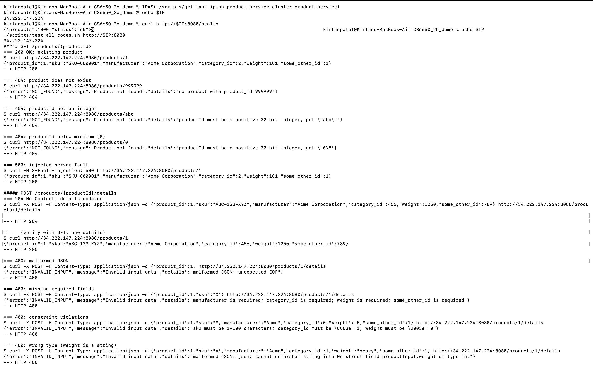

The screenshot shows the health check, every GET case (200, 404, and the 500 check returning 200 because fault injection is off), the POST 204 with a follow-up GET proving the update was stored in the task's memory, and the POST 400 cases for malformed JSON, missing fields, constraint violations and wrong types.

## Deploy to AWS on any machine

**Prerequisites:** AWS CLI v2, Terraform ≥ 1.5, Docker Desktop running, and AWS credentials. On AWS Academy Learner Lab: start the lab, open **AWS Details → AWS CLI: Show**, copy the block, and write it to the credentials file (repeat every lab session; the credentials expire):

```bash
pbpaste > ~/.aws/credentials          # macOS; or paste it into the file with an editor
aws configure set region us-west-2
aws sts get-caller-identity           # should print your account ID
```

**Deploy:**

```bash
git clone https://github.com/Kirtan10/CS6650_2b_demo.git
cd CS6650_2b_demo/terraform

# macOS with newer Docker Desktop: tell Terraform's Docker provider where the socket is
export DOCKER_HOST=$(docker context inspect --format '{{.Endpoints.docker.Host}}')

terraform init
terraform plan                        # 8 to add
terraform apply                       # type yes: builds the image, pushes to ECR, starts ECS
```

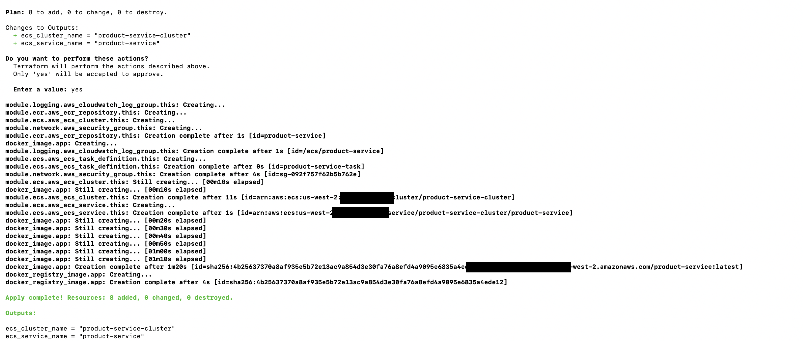

*(AWS account ID redacted.)*

**Find the server and test it** (the task takes 1–2 minutes to reach RUNNING):

```bash
cd ..
IP=$(./scripts/get_task_ip.sh product-service-cluster product-service)
curl http://$IP:8080/health           # {"products":1000,"status":"ok"}
./scripts/test_all_codes.sh http://$IP:8080
```

The task's public IP changes every time it starts, so always look it up rather than reusing an old one.

**Logs:** every request is one JSON line in CloudWatch: ECS → `product-service-cluster` → `product-service` → **Logs**, or `aws logs tail /ecs/product-service --follow`.

**Tear down** when finished, so the lab budget isn't spent on an idle service:

```bash
cd terraform && terraform destroy
```

**To redeploy after a code change:** Terraform doesn't rebuild an image whose name hasn't changed, so force it with `terraform apply -replace=docker_image.app -replace=docker_registry_image.app`.

### What the Terraform files do

| File | Role |
|---|---|
| `provider.tf` | Configures the AWS provider (region, credentials from `~/.aws`) and the Docker provider, which logs in to ECR with a temporary token so Terraform can push the image |
| `variables.tf` | Inputs: region, ECR repository name, service name, `container_port` (8080), task count, log retention |
| `modules/` | `network` (security group opening 8080, default VPC subnets), `ecr` (image repository), `logging` (CloudWatch log group), `ecs` (cluster, task definition, service) |
| `main.tf` | Calls the modules and wires their outputs together, reuses Learner Lab's `LabRole`, and builds and pushes `../src` as `:latest` |
| `output.tf` | Prints the cluster and service names, used to look up the task IP |

### What I changed from the starter repo

1. Deleted `src/main.go` (the albums server) and added `product-service.go`, `go.mod` and `go.sum`.
2. Replaced `src/Dockerfile` with the multi-stage Product API Dockerfile, keeping its name and location so Terraform's build context (`../src`) still finds it.
3. Kept the server on port 8080 to match `container_port`.
4. In `terraform/variables.tf`, renamed `ecr_repository_name` from `ecr_service` and `service_name` from `CS6650L2` to `product-service`. This creates `product-service-cluster`, the `product-service` ECS service and ECR repository, the `/ecs/product-service` log group and `product-service-sg`.
5. Added `platform = "linux/amd64"` to the `docker_image` build block in `terraform/main.tf`. An Apple Silicon Mac otherwise builds an ARM image, which Fargate (x86_64) can't run.
6. Documented the `DOCKER_HOST` export above, needed on macOS so Terraform's Docker provider can find Docker Desktop's socket.

## Part IV: Load and stress testing

All tests target the deployed ECS task (0.25 vCPU, 512 MB) from a laptop in Boston, so every request crosses the country to us-west-2 and back.

```bash
cd locust
CLIENT=fast WAIT=normal docker compose up                              # runs 1-2 (CLIENT=http or fast)
CLIENT=fast WAIT=none STEP_SHAPE=1 docker compose up --scale worker=4  # run 5, stress test
# open http://localhost:8089; Host = http://<TASK_PUBLIC_IP>:8080 (no trailing slash)
```

| Knob | Options | Use |
|---|---|---|
| `CLIENT` | `http` / `fast` | HttpUser (python-requests) vs FastHttpUser (geventhttpclient) |
| `WAIT` | `normal` / `none` | 0.1–0.5 s think time vs none (stress) |
| `STEP_SHAPE` | unset / `1` | Automatic ramp: +100 users every 60 s up to 1,000 |
| `--scale worker=N` | 1, 4 | Number of load-generating workers |

**Request mix (task weights):** 80% GET existing product, 15% POST valid details, 3% GET missing product (expects 404), 2% POST invalid body (expects 400). Browsing dominates real stores, so reads dominate the mix. The expected 404s and 400s are marked as successes, so the failure rate counts only real problems.

### Test design

| Run | Client | Workers | Users / spawn rate | Think time | Purpose |
|---|---|---|---|---|---|
| 1 | HttpUser | 1 | 50 / 10 | 0.1–0.5 s | Baseline, same setup as HW3 |
| 2 | FastHttpUser | 1 | 50 / 10 | 0.1–0.5 s | Client comparison at the same offered load |
| 5 | FastHttpUser | 4 | step shape: +100 every 60 s to 1,000 | none | Stress test: find where the server stops scaling |

### Runs 1 and 2: HttpUser vs FastHttpUser

| | Run 1: HttpUser | Run 2: FastHttpUser |
|---|---|---|
| Duration / requests | ~3 m 48 s / 28,246 | ~2 m 12 s / 16,548 |
| **RPS** | 124.2 | **125.2** |
| Failures | 0 | **0** |
| Average | 95 ms | **91 ms** |
| Median / p95 / p99 | 91 / 120 / 190 ms | **88 / 120 / 180 ms** |
| p99.9 / Max | 400 / 480 ms | **360 / 379 ms** |
| Min | 75 ms | 75 ms |
| **Worker CPU** | ~17.8% | **~11.4%** (about 35% less) |

**Run 1, HttpUser:**

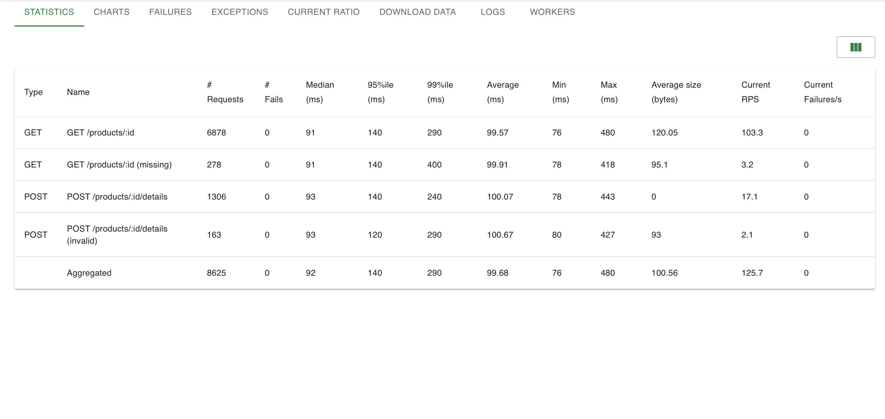
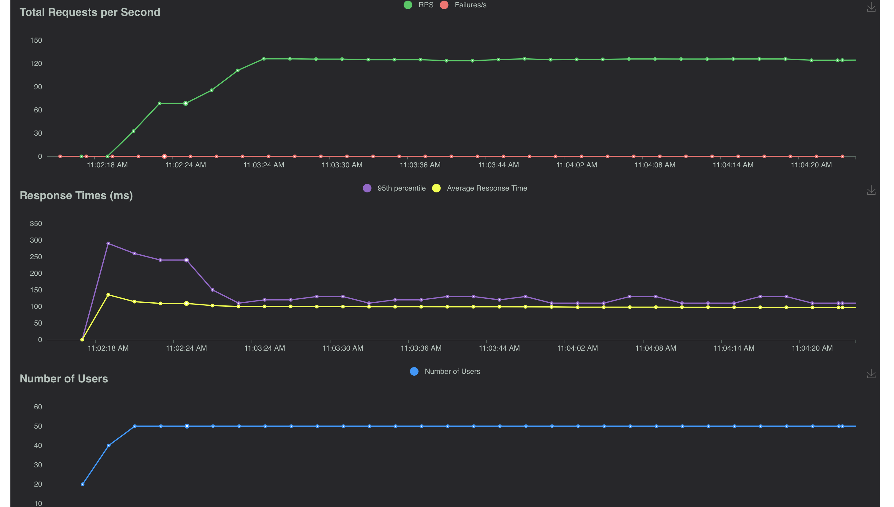
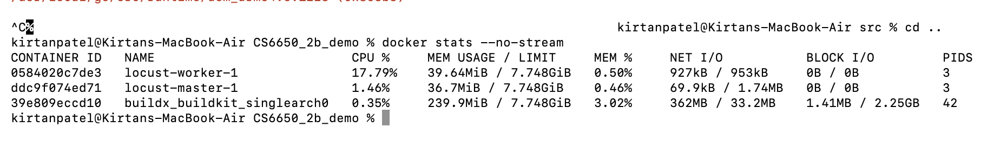
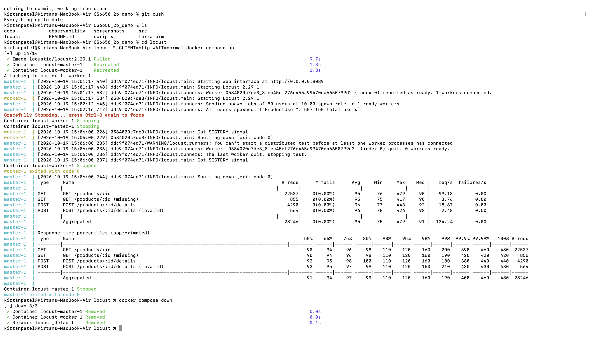

**Run 2, FastHttpUser:**

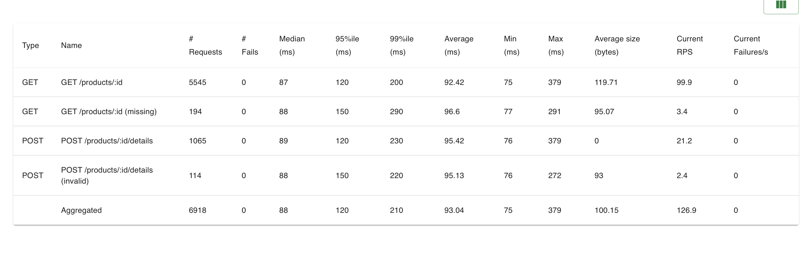
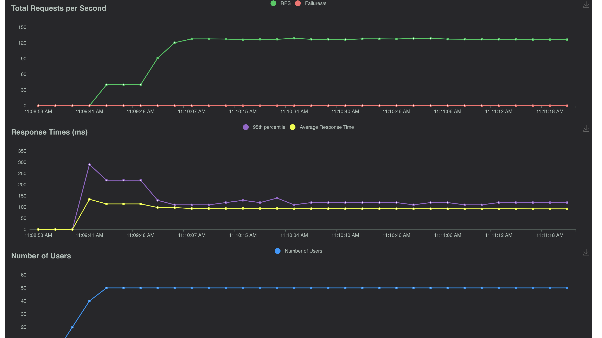
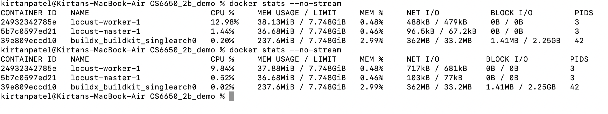
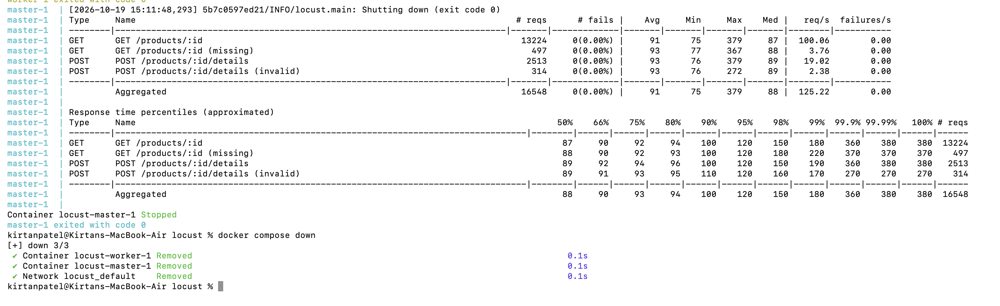

**Analysis.** Both clients produced the same throughput (124 vs 125 RPS) with zero failures. In a closed-loop test the offered load is set by the users, not the client library: each user waits for a response (~0.1 s) and then thinks for 0.3 s on average, so 50 users ÷ 0.4 s ≈ **125 RPS**, exactly what was measured. The difference showed up in client cost: FastHttpUser generated the same load with about **35% less worker CPU** (≈11% vs ≈18%), and latency was slightly lower (median 88 vs 91 ms). Most of each ~90 ms request is the Boston–Oregon round trip (the minimum was 75 ms) while the server spends well under a millisecond, so the 3–4 ms gain is client overhead removed and is close to network noise. The startup spike in both charts (p95 ≈ 290 ms) is new TCP connections paying an extra round trip for the handshake before keep-alive reuse kicks in.

**Why:** HttpUser uses python-requests, which is pure Python and builds session, prepared-request and response objects for every call. FastHttpUser uses geventhttpclient, whose HTTP parser is written in C and which was designed for gevent's greenlets, the lightweight user-level threads Locust runs each simulated user on. Because the GIL limits a Python worker to roughly one core, cheaper requests mean one worker can simulate more users before the load generator, rather than the server, becomes the bottleneck. A throughput difference would appear only once a worker's CPU is the limit; with think time capping the load at ~125 RPS it never was. That's why the stress test uses FastHttpUser with 4 workers.

### Run 5: stress test

FastHttpUser, 4 workers, no think time, +100 users every 60 s up to 1,000. 11 minutes, **1.94 million requests, 0 failures**. Per-step numbers are steady-state medians from the full-run Locust report ([`screenshots/locust/run5-report.html`](screenshots/locust/run5-report.html); download and open it in a browser for the interactive charts).

| Users | Healthy RPS (users ÷ 0.1 s) | Measured RPS | p95 | Time per request (users ÷ RPS) |
|---|---|---|---|---|
| 100 | 1,000 | 997 | 110 ms | 100 ms |
| 200 | 2,000 | 1,963 | 120 ms | 102 ms |
| **300** | 3,000 | **2,785** | **150 ms** | 108 ms |
| 400 | 4,000 | 2,961 | 190 ms | 135 ms |
| 500 | 5,000 | 3,147 | 215 ms | 159 ms |
| 600 | 6,000 | 3,380 | 290 ms | 178 ms |
| 700 | 7,000 | 3,431 | 315 ms | 204 ms |
| 800 | 8,000 | 3,504 | 385 ms | 228 ms |
| 900 | 9,000 | 3,449 | 405 ms | 261 ms |
| 1000 | 10,000 | 3,462 | 470 ms | 289 ms |

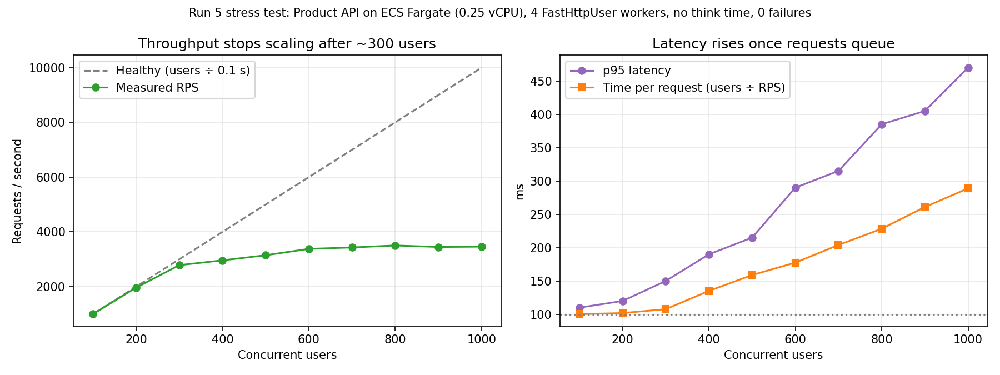

**100 users** (healthy: ~1,000 RPS at ~100 ms):
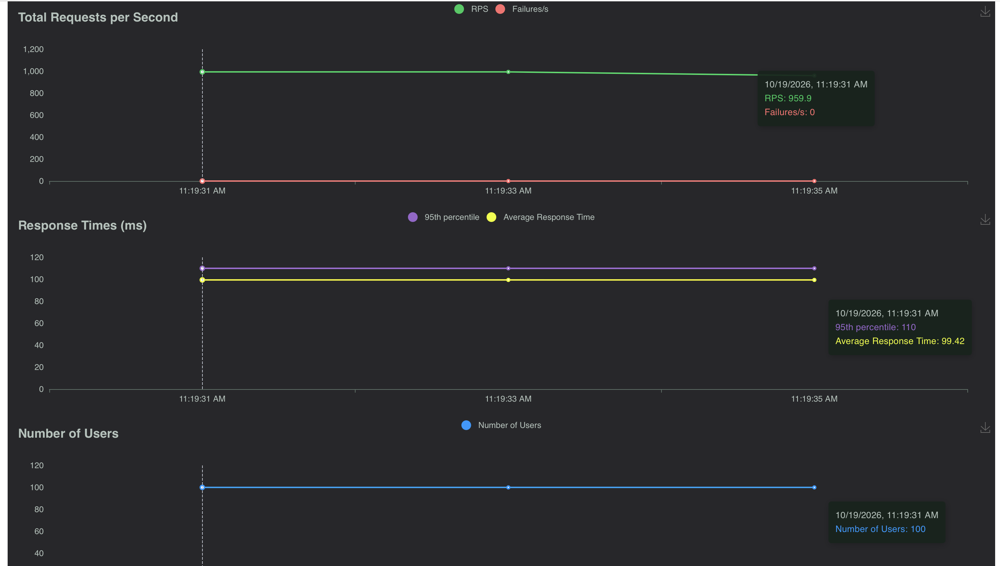

**200 users** (still healthy: ~1,970 RPS, latency unchanged):
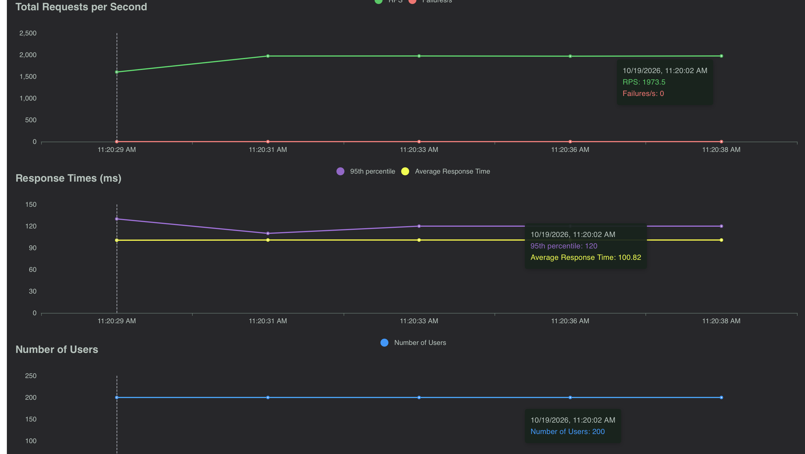

**800 users** (saturated: ~3,500 RPS instead of 8,000, p95 380 ms and climbing):
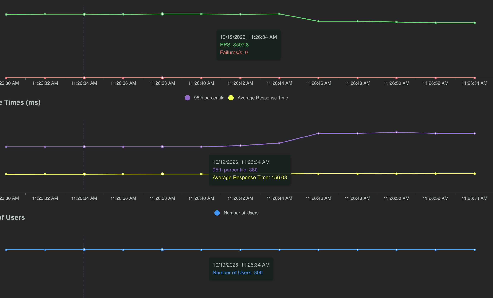

**Load generator was not the bottleneck.** `docker stats` during the run, with the four workers at ~18–24% CPU each (the last snapshot was taken after the test ended):

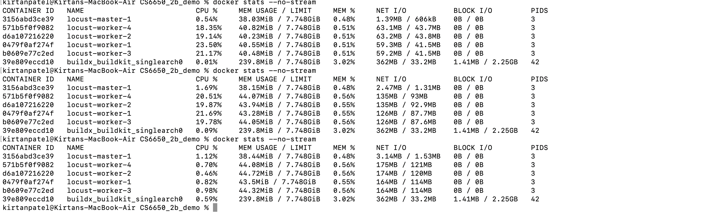

The key snapshot under heavy load:

```
NAME              CPU %     MEM USAGE / LIMIT     NET I/O
locust-master-1   1.69%     38.15MiB / 7.748GiB   2.47MB / 1.31MB
locust-worker-4   20.51%    44.07MiB / 7.748GiB   135MB / 93MB
locust-worker-2   19.87%    43.94MiB / 7.748GiB   135MB / 92.9MB
locust-worker-1   21.69%    43.28MiB / 7.748GiB   126MB / 87.7MB
locust-worker-3   19.78%    44.05MiB / 7.748GiB   126MB / 87.6MB
```

**Where the server started to struggle, and why.** With no think time, a healthy server gives RPS ≈ users ÷ response time. That held through 200 users, at ~100 ms per request, almost all of it network round trip. **The breaking point was 300 users**: RPS fell short of the expected 3,000 for the first time (2,785) and p95 rose from 120 to 150 ms. From 400 users on, throughput plateaued at **~3,000–3,500 RPS** and stayed there up to 1,000 users, while p95 climbed steadily to 470 ms. Using Little's law (users = throughput × time per request), the time per request grew from 100 to 289 ms; since the network round trip stayed ~100 ms, everything above it is time spent **queueing**. There were zero failures: the server never rejected work, it just made requests wait. The four Locust workers stayed at ~20% CPU each, so the limit was on the server side, most likely the **0.25 vCPU** Fargate task: every request costs CPU for HTTP parsing, JSON encoding, Prometheus updates and a JSON log line, and once that CPU is busy, extra users only add waiting time, which shows up in tail latency first. To scale further: more vCPU per task, more tasks behind a load balancer (which requires moving the in-memory map to a shared store such as DynamoDB or Redis, since each task would otherwise have its own copy), and cheaper per-request logging (sampling or buffered output).

### Tradeoffs

**Which operations are most common, and how does that affect the data structure?** Customers browse far more than sellers edit listings, so reads dominate (80% in this mix; often 90%+ in real stores). A hash map gives O(1) lookups by ID regardless of catalog size, and the RWMutex lets concurrent GETs share the read lock while only the rarer POSTs need exclusive access. If writes became common, the single global lock would serialize them and become the bottleneck; the next steps would be sharding the map (N maps, each with its own lock, chosen by `id % N`) or `sync.Map` for read-mostly keys. What a map can't do is answer queries other than "by ID" (for example, every product in category 5) without a full scan, which is why a real store adds a database with indexes. And because the data lives in one process's memory, it's lost on restart and can't be shared between tasks.

## Part V: Observability

**RED signals tracked for every endpoint:**

| Signal | Metric | Grafana query |
|---|---|---|
| Rate | `http_requests_total` (counter) | `sum by (method, route) (rate(http_requests_total[30s]))` |
| Errors | `http_request_errors_total` (counter of non-2xx) | errors ÷ total × 100, per route |
| Duration | `http_request_duration_seconds` (histogram) | `histogram_quantile(0.95, sum by (le, route) (rate(..._bucket[30s])))` |

Metrics are labelled with the **route template** (`/products/:productId`), not the raw path, so 1,000 product IDs don't become 1,000 time series. Requests that match no route are labelled `unmatched`. The dashboard also shows goroutines and heap as saturation hints.

```bash
cd observability
docker compose up --build
# API http://localhost:8080 · Prometheus http://localhost:9090 · Grafana http://localhost:3000
```

Prometheus and Grafana run locally, as the assignment instructs, so for this part Locust targeted the local container at `http://host.docker.internal:8080` with the same locustfile and request mix (FastHttpUser, 100 users, normal think time).

### Dashboard: idle

Before any load, the Rate panel shows the single test request as a flat 0 req/s line, the Duration panel has no values (no requests in the window), and the runtime panel shows the idle baseline: ~6 goroutines and a heap sawtooth from garbage collection.

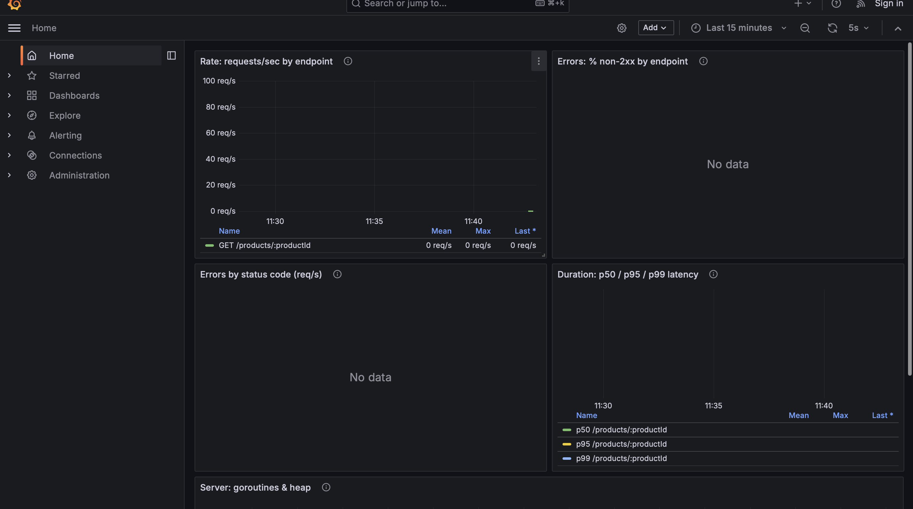

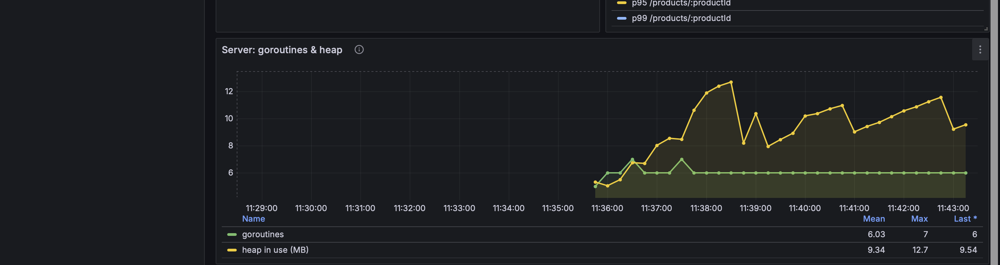

### Dashboard: idle vs loaded

The same dashboard over the last 15 minutes, covering idle, a misconfigured load run, and the correct load run:

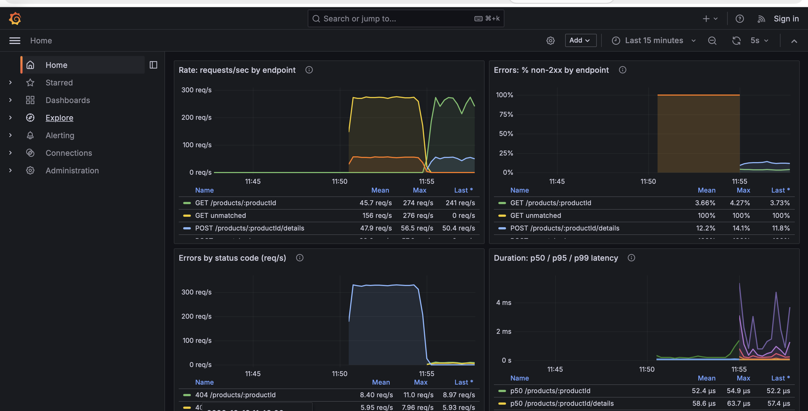

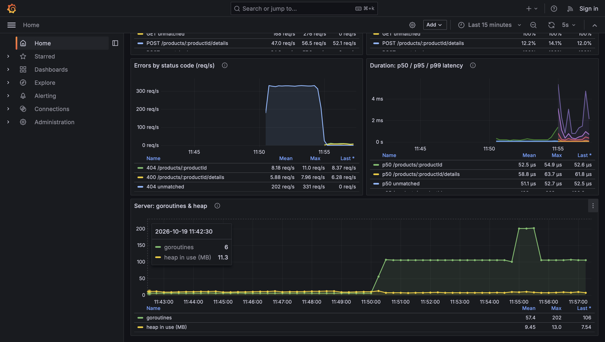

The dashboard (last 15 minutes) shows three phases:

- **Idle (11:42–11:50):** no request series (counters are created on first use, so there is nothing to plot before traffic), ~6 goroutines, and a healthy heap sawtooth between ~5 and 13 MB as the garbage collector runs.
- **Misconfigured load (11:50–11:55):** Locust was accidentally pointed at the host with a trailing slash, so every request went to `//products/...`. The dashboard immediately showed only `GET unmatched` and `POST unmatched` at ~330 req/s with **100% errors**, all `404 unmatched`. The route label pinpointed the cause within seconds; this is exactly what the errors-by-endpoint panel is for.
  On the Locust side, the same mistake showed up as 100% failures:

  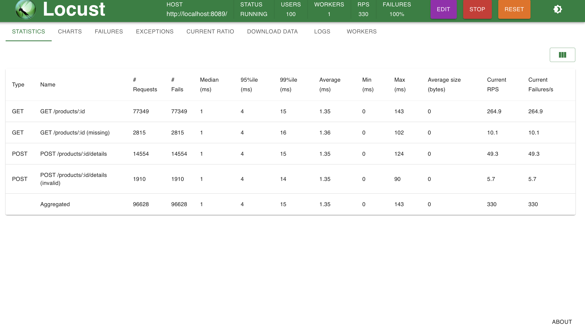

- **Correct load (11:55 on):** `GET /products/:productId` at ~250 req/s and POST at ~50 req/s. Error rates were **3.7% for GET** and **~12% for POST**, matching the deliberate tasks in the mix (3 missing GETs out of every 83 GETs; 2 invalid POSTs out of every 17 POSTs). Server-side **p50 was ~55 µs** with p95/p99 under ~4 ms, while Locust measured ~20 ms for the same requests, so most client-side latency was Docker Desktop's networking, not the server. Goroutines rose from 6 to ~106, about one per connected user, and briefly to ~200 while the old and new connections overlapped. After resetting Locust, failures dropped to 0:

  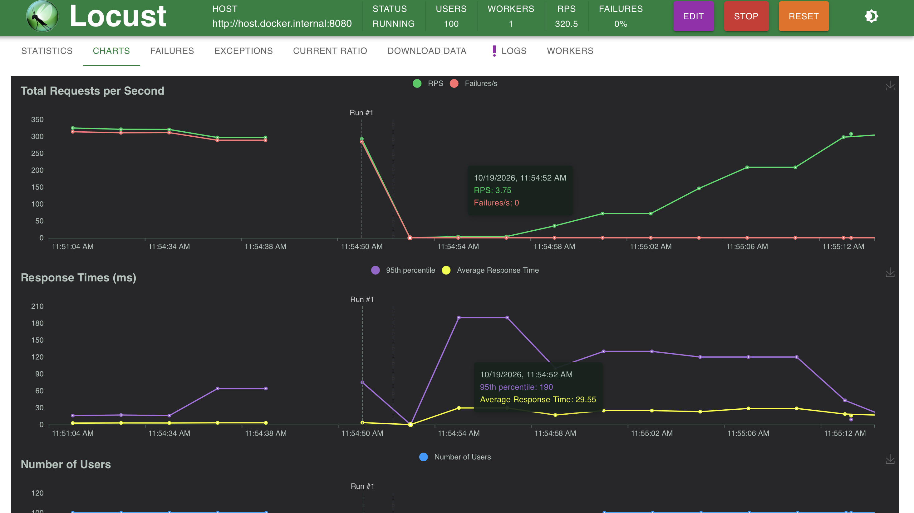

During idle, the Errors % panel has gaps: with zero requests the error percentage is 0 ÷ 0, which is undefined, so Grafana plots nothing.

### Request logs

One structured JSON line per request goes to stdout (CloudWatch on ECS), with endpoint, status and duration: the same RED data, recoverable after the fact. Excerpt from the local container (full file: [`screenshots/grafana/request-log-excerpt.txt`](screenshots/grafana/request-log-excerpt.txt)):

```json
{"time":"2026-10-19T14:25:23.853658133Z","level":"INFO","msg":"request","method":"GET","endpoint":"/products/:productId","path":"/products/1","status":200,"duration_ms":1.33,"bytes":116,"client_ip":"192.168.65.1"}
{"time":"2026-10-19T14:25:23.889920799Z","level":"INFO","msg":"request","method":"GET","endpoint":"/products/:productId","path":"/products/999999","status":404,"duration_ms":0.962,"bytes":97,"client_ip":"192.168.65.1"}
{"time":"2026-10-19T14:25:23.996837966Z","level":"INFO","msg":"request","method":"POST","endpoint":"/products/:productId/details","path":"/products/1/details","status":204,"duration_ms":0.137,"bytes":-1,"client_ip":"192.168.65.1"}
{"time":"2026-10-19T14:25:24.045137924Z","level":"INFO","msg":"request","method":"POST","endpoint":"/products/:productId/details","path":"/products/1/details","status":400,"duration_ms":0.096,"bytes":99,"client_ip":"192.168.65.1"}
{"time":"2026-10-19T14:25:24.202660424Z","level":"ERROR","msg":"panic recovered","error":"injected fault for testing the 500 response","path":"/products/1/details"}
{"time":"2026-10-19T14:25:24.203128008Z","level":"INFO","msg":"request","method":"POST","endpoint":"/products/:productId/details","path":"/products/1/details","status":500,"duration_ms":0.895,"bytes":60,"client_ip":"192.168.65.1"}
```

During the Locust run the server writes the same line format for every request, so the same fields can be filtered and aggregated for any time window. To pull lines from the running stack:

```bash
cd observability
docker compose logs product-service --no-log-prefix | grep '"msg":"request"' | tail -15 > ../screenshots/grafana/request-log-excerpt.txt
```

Each line's `endpoint` is the route template, `path` the actual URL, `status` the response code and `duration_ms` the server-side time, so the RED signals for any time window can be rebuilt by filtering and aggregating these lines.

### Dashboard vs logs

I'd look at the **dashboard** to notice and scope a problem while it's happening: whether traffic changed, whether errors are spiking, which endpoint's p95 moved, and when. I'd look at the **logs** afterwards to explain a specific problem: exactly which requests failed, with which paths and status codes, at what time, especially when nobody had Grafana open when it happened. In the misconfigured run above, the dashboard showed *that* every request was a 404 on an `unmatched` route; the logs showed *why*, with paths like `//products/42`.

